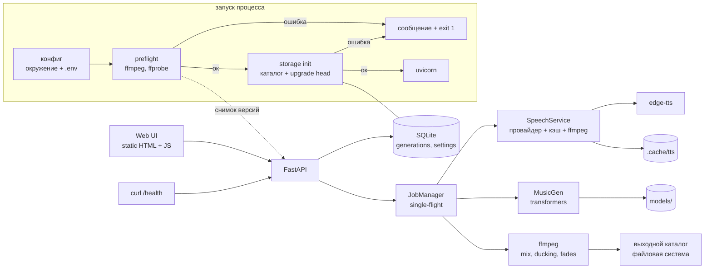
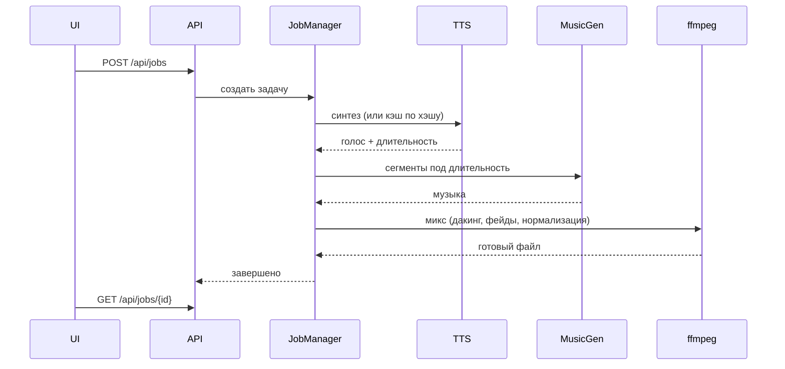

# Архитектура

Черновик. Описывает плановую архитектуру; обновляется при архивации каждого
change, который меняет компоненты, потоки или зависимости.

## Компоненты

Сейчас реализованы конфиг, preflight, хранилище (`storage/`), слой речи
(`speech/`: провайдер edge-tts, кэш, ffmpeg-обработка) и `GET /api/health`.
Очередь задач, музыка, микс и UI — план последующих фаз.

## Поток генерации

План последующих фаз. Реализован пока только `GET /api/health`, который отдаёт
снимок preflight; генерации нет.

## Решения и ограничения

- Preflight выполняется до открытия порта: без рабочих `ffmpeg` и `ffprobe`
  процесс завершается с кодом 1, сервиса нет.
- Снимок preflight неизменяем и кладётся в состояние приложения; health его
  только сериализует, внешние процессы на запросах не запускаются.
- Хранилище — SQLite с WAL, синхронный SQLAlchemy 2.0; схема приводится к
  последней ревизии Alembic при старте, `create_all` не используется.
- Речь синтезируется синхронным слоем: провайдер за протоколом (сейчас
  edge-tts), кэш в `.cache/tts` с ключом по тексту и параметрам и лимитом в
  МиБ, длительность — по `ffprobe`, «рык» — ffmpeg-фильтр с сохранением
  длительности.
- Время в базе — naive UTC, на границе слоя превращается в aware-UTC
  (`UTCDateTime`); коммит транзакций — на вызывающей стороне.
- Одна модель MusicGen в памяти, одна генерация одновременно.
- Окно модели — 30 с; длиннее — сегменты с кроссфейдом.
- На MPS считается в `float32`; CPU-режим возможен, но медленный.
- TTS-кэш по хэшу текста: перегенерация музыки не переозвучивает.
- Документация и спецификации — в репозитории; внешних систем нет.

## Что обновлять при изменениях

- Новый компонент или зависимость → схема выше и раздел «Решения».
- Изменение потока → sequence-диаграмма.
- Изменение формата файлов или каталогов → раздел в `operations.md`.
