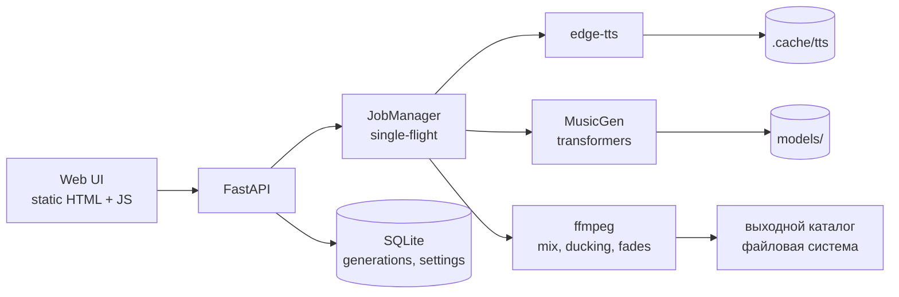
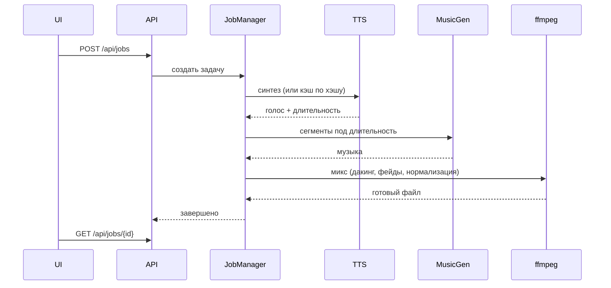

# Архитектура

Черновик. Описывает плановую архитектуру; обновляется при архивации каждого
change, который меняет компоненты, потоки или зависимости.

## Компоненты

## Поток генерации

## Решения и ограничения

- Одна модель MusicGen в памяти, одна генерация одновременно.
- Окно модели — 30 с; длиннее — сегменты с кроссфейдом.
- На MPS считается в `float32`; CPU-режим возможен, но медленный.
- TTS-кэш по хэшу текста: перегенерация музыки не переозвучивает.
- Документация и спецификации — в репозитории; внешних систем нет.

## Что обновлять при изменениях

- Новый компонент или зависимость → схема выше и раздел «Решения».
- Изменение потока → sequence-диаграмма.
- Изменение формата файлов или каталогов → раздел в `operations.md`.
