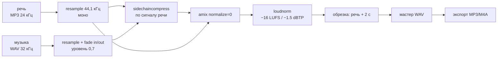

# Сведение речи и музыки

> **Автосгенерировано** из OpenSpec capability `audio-assembly`. Не редактировать
> вручную: изменения вносятся через OpenSpec change. Автор изменений: Andrey Zaharov.
> Дата: 2026-11-26.
>
> Внутренний источник: OpenSpec в этом репозитории, `openspec/specs/audio-assembly/spec.md`.
> Публичной ссылки на спеку нет.

## Что это

Накладывает озвученный текст на музыкальную подложку так, чтобы речь читалась:
музыка приглушается по сигналу речи, возвращается в паузах, начинается и
заканчивается плавно, а итоговая громкость предсказуема.

Поведение описано требованиями «Дакинг музыки под речь», «Фейды и хвост»,
«Длительность результата», «Нормализация громкости» и «Единый результат».

## Ключевые понятия

| Термин | Значение |
|---|---|
| Дакинг | Автоматическое понижение музыки, пока звучит речь |
| Sidechain | Управляющий сигнал: речь задаёт громкость музыки |
| Хвост | 2 секунды музыки после окончания речи |
| LUFS | Единица громкости; целевое значение −16 |
| dBTP | Истинный пик; ограничен −1,5 дБ, чтобы не клиппировало |

## Как работает

1. Длительности речи и музыки измеряются по файлам через `ffprobe`.
2. Если музыки меньше, чем «речь + 2 секунды», микс не начинается.
3. Оба входа приводятся к 44,1 кГц, моно.
4. Музыка получает нарастание 2 с, базовый уровень 0,7 и затухание 2 с в конце.
5. Sidechain-компрессор приглушает музыку по сигналу речи и отпускает её в
   паузах (release 350 мс).
6. Речь и приглушённая музыка суммируются без деления на число входов, затем
   итог нормализуется до −16 LUFS с пиком не выше −1,5 dBTP.
7. Результат обрезается до «речь + 2 секунды».

## Контракты

Вход: путь к речи, путь к музыке, текст (для имени файла в слое файлов).
Выход: длительность по готовому файлу и пути к экспортированным файлам.

Константы микса (в `assembly/mix.py`): базовая громкость музыки 0,7, порог
дакинга 0,02, степень 8, атака 20 мс, релиз 350 мс, фейды 2 с, хвост 2 с,
цель −16 LUFS / −1,5 dBTP.

Ошибки: `AssemblyError` → `InsufficientMusicError` (музыка короче нужного),
`EncodingError` (ffmpeg не смог), `UnknownFormatError`, `OutputWriteError`.

## Диаграммы

## Ошибки и ограничения

- Мало музыки — микс не выполняется; слой музыки должен запрашивать
  `речь + хвост` с запасом.
- Дакинг подобран под обычную речь; шёпот и крик могут потребовать подстройки
  констант.
- Одновременный запуск двух миксов не сериализуется: это задача очереди (фаза 7).
- Стерео не поддерживается: исходники моно, выход моно 44,1 кГц.

## Диагностика (QA)

- Длительность результата: `ffprobe -v error -show_entries format=duration -of default=nw=1:nk=1 <файл>`.
- Громкость и пик: `ffmpeg -hide_banner -i <файл> -af ebur128 -f null -` —
  смотреть Integrated и True peak.
- «Музыка перекрывает речь» — проверить исходную громкость речи: микс выравнивает
  общий уровень, но не восстанавливает провалы в записи речи.
- «Слышно, как музыка дышит» — релиз 350 мс велик для быстрых реплик; параметры
  в `assembly/mix.py`.
- Тесты: `uv run pytest tests/test_mix_*.py`.

## Ссылки

- Код: `src/muzifikator/assembly/mix.py`, `src/muzifikator/assembly/service.py`.
- Смежные capability: `speech-synthesis`, `music-generation`, `output-files`.
