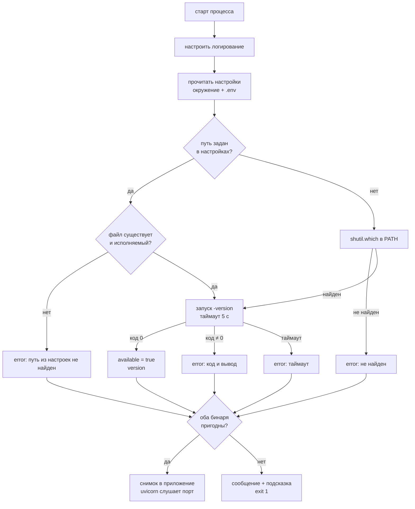

# Preflight ffmpeg и ffprobe

> **Автосгенерировано** из OpenSpec capability `ffmpeg-preflight`. Не редактировать
> вручную: изменения вносятся через OpenSpec change. Автор изменений: Andrey Zaharov.
> Дата: 2026-11-25.
>
> Внутренний источник: OpenSpec в этом репозитории, `openspec/specs/ffmpeg-preflight/spec.md`.
> Публичной ссылки на спеку нет.

## Что это

Проверка внешнего окружения перед стартом. Приложение работает только там, где
есть `ffmpeg` и `ffprobe`: ими режутся, склеиваются и нормализуются все аудио.
Поэтому проверка делается до открытия порта, а не в момент первой генерации —
иначе пользователь узнал бы о проблеме после долгой загрузки модели.

Поведение описано требованиями «Обнаружение бинарей», «Проверка запуска и
версии», «Отказ старта при непригодном окружении», «Подсказка по установке» и
«Однократная проверка».

## Ключевые понятия

| Термин | Значение |
|---|---|
| Preflight | Однократная проверка окружения при старте процесса |
| Снимок (snapshot) | Неизменяемый результат проверки: путь, версия, ошибка для каждого бинаря |
| Непригодный бинарь | Обнаружен, но не запускается, падает с ошибкой или не отвечает за таймаут |
| `FFMPEG_BIN`, `FFPROBE_BIN` | Необязательные переменные окружения с явным путём к бинарю |

## Как работает

1. Точка входа настраивает логирование по `LOG_LEVEL`.
2. Настройки читаются из окружения и локального `.env`.
3. Для каждого бинаря выбирается путь: значение из `FFMPEG_BIN`/`FFPROBE_BIN`,
   иначе поиск в `PATH`.
4. Каждый найденный бинарь запускается с `-version` и таймаутом 5 секунд.
5. Из вывода извлекается версия; код возврата, таймаут и отсутствие файла
   превращаются в текст ошибки в снимке.
6. Если оба пригодны — снимок передаётся приложению и порт открывается.
   Если нет — печатается единое сообщение и процесс завершается с кодом 1.

## Контракты

Снимок одного бинаря:

| Поле | Тип | Смысл |
|---|---|---|
| `available` | bool | Бинарь пригоден к работе |
| `path` | строка или null | Разрешённый путь к исполняемому файлу |
| `version` | строка или null | Версия из вывода `-version`; null — извлечь не удалось |
| `error` | строка или null | Почему бинарь непригоден |

Снимок целиком дополнительно содержит `ok` — истинно, только если оба бинаря
пригодны. Снимок не меняется в течение жизни процесса.

Сообщение об отказе содержит: перечень проблемных бинарей с причиной, команды
установки для macOS (`brew install ffmpeg`), Debian/Ubuntu
(`sudo apt install ffmpeg`) и Fedora (`sudo dnf install ffmpeg`, RPM Fusion),
напоминание про `FFMPEG_BIN` и `FFPROBE_BIN`.

## Диаграммы

## Ошибки и ограничения

- Порт не открывается при любой проблеме — снаружи это выглядит как
  «приложение не запустилось», а причина только в выводе процесса.
- Явный путь в `FFMPEG_BIN`/`FFPROBE_BIN` не откатывается на `PATH`: если файла
  нет, это ошибка, а не повод искать другой бинарь.
- Таймаут 5 секунд — компромисс между медленным первым запуском и зависшим
  бинарём; при ложном отказе значение меняется в одном месте модуля.
- Неизвестная версия не является ошибкой: сборки печатают по-разному.
- Проверка не повторяется на запросах: переустановка ffmpeg на работающем
  сервисе подхватится только после перезапуска.

## Диагностика (QA)

- Запустить `ffmpeg -version` и `ffprobe -version` руками — должно работать в
  том же окружении, из которого стартует приложение.
- Проверить, что видит приложение: `uv run muzifikator` и посмотреть строки
  preflight в stderr.
- Если задан `FFMPEG_BIN`, убедиться, что путь абсолютный и файл исполняемый.
- `echo $PATH` в том терминале, где запускается сервис (IDE и shell могут иметь
  разные `PATH`).
- Без ffmpeg в `PATH` приложение обязано завершиться с кодом 1 и сообщением об
  установке — это ожидаемое поведение, а не баг.

## Ссылки

- Код: `src/muzifikator/preflight.py`.
- Запуск и установка: `docs/operations.md`.
- Смежные capability: `service-health` (публикует снимок preflight).
