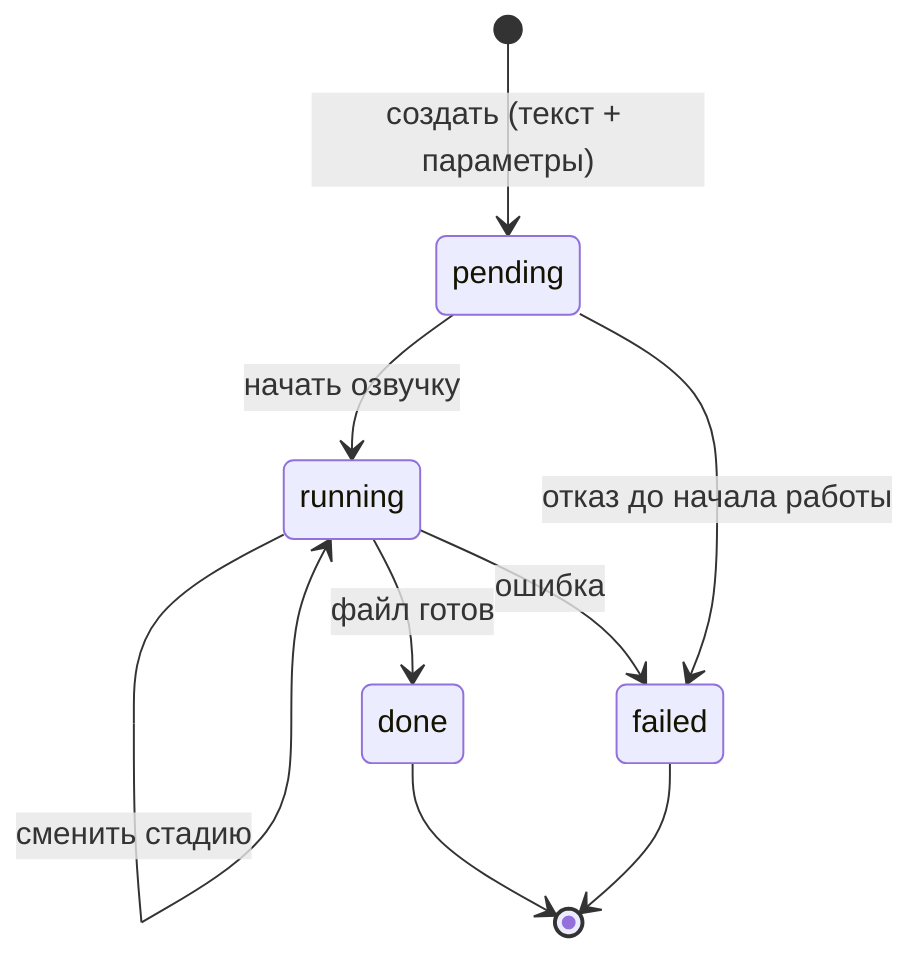

# История генераций

> **Автосгенерировано** из OpenSpec capability `generation-history`. Не редактировать
> вручную: изменения вносятся через OpenSpec change. Автор изменений: Andrey Zaharov.
> Дата: 2026-11-26.
>
> Внутренний источник: OpenSpec в этом репозитории, `openspec/specs/generation-history/spec.md`.
> Публичной ссылки на спеку нет.

## Что это

Запись о каждой генерации: что просили, с какими настройками, на какой стадии
остановились, чем закончилось и где лежит файл. Нужна, чтобы история не терялась
при перезапуске и чтобы падение на середине было видно, а не превращалось в
молчаливую потерю.

Поведение описано требованиями «Создание записи о генерации», «Переходы
статусов», «Стадия выполнения», «Результат генерации», «Файлы результата»,
«Чтение истории» и «Сохранность между перезапусками».

## Ключевые понятия

| Термин | Значение |
|---|---|
| Запись (generation) | Строка таблицы `generations`: одна попытка получить аудио |
| Статус | `pending`, `running`, `done`, `failed` |
| Стадия | Этап работы: `tts`, `music`, `mix`; есть только у `running` |
| Терминальный статус | `done` или `failed`; такая запись больше не меняется |

## Как работает

Запись создаётся до начала работы, в статусе `pending`. Когда начинается
озвучка, запись переходит в `running` и получает стадию; стадия меняется по
мере продвижения. Успех выставляет `done` и заполняет путь к файлу и
длительность; ошибка выставляет `failed` и сохраняет текст ошибки.

Идентификатор — uuid4 в hex-виде, поэтому запись можно назвать до того, как она
появилась в базе, и передавать между стадиями. Время — UTC.

## Контракты

Таблица `generations`:

| Поле | Обязательно | Смысл |
|---|---|---|
| `id` | да | UUID генерации |
| `created_at` | да | Время создания, UTC |
| `finished_at` | при `done`/`failed` | Время завершения, UTC |
| `text` | да | Входной текст |
| `tts_provider`, `voice` | нет | Чем и каким голосом озвучивали |
| `music_tags`, `music_seed` | нет | Параметры музыки |
| `status` | да | `pending`/`running`/`done`/`failed` |
| `stage` | нет | `tts`/`music`/`mix` |
| `output_path` | при `done` | Путь к основному файлу (MP3) |
| `duration_seconds` | при `done` | Длительность результата |
| `error` | при `failed` | Текст ошибки |

Допустимые переходы: `pending → running`, `running → done`, `running →
failed`, `pending → failed`. Любой другой переход отклоняется с ошибкой
`InvalidTransitionError`.

Файлы результата лежат в таблице `generation_files`: одна строка на формат,
ключ `(generation_id, format)`, путь к файлу. `generations.output_path`
по-прежнему хранит основной файл (MP3) для совместимости, но истина о наборе
файлов — в `generation_files`.

Чтение: список от новых к старым с лимитом (по умолчанию 50), запись по
идентификатору; неизвестный идентификатор даёт «нет записи», а не ошибку.

## Диаграммы

## Ошибки и ограничения

- Запись в терминальном статусе не редактируется: повторное завершение — ошибка,
  а не «обновление».
- Слой доступа не коммитит транзакции сам; коммит делает вызывающий код. Поэтому
  в тестах и в фазе 6 изменения видны только после `session.commit()`.
- Стадия у записи, которая ещё не в `running`, не сохраняется — это ошибка
  порядка вызовов, а не данных.
- Удаление записей не предусмотрено: история только растёт. Чистка — отдельное
  решение, когда станет нужно.
- Файлы результата связаны с записью через `generation_files`; при ошибке задачи
  строк файлов нет. Удаление файла с диска не удаляет строку — история помнит
  путь.

## Диагностика (QA)

- База: `data/muzifikator.sqlite3`; посмотреть содержимое —
  `sqlite3 data/muzifikator.sqlite3 'select id,status,stage,created_at from generations order by created_at desc limit 20;'`.
- «Запись есть, но пустая» — процесс упал между созданием и первым переходом;
  статус `pending` подтверждает это.
- «Не меняется статус» — проверить, сделан ли `commit`: слой доступа не
  коммитит сам.
- Тесты слоя: `uv run pytest tests/test_history.py`.

## Ссылки

- Код: `src/muzifikator/storage/repo.py`, `src/muzifikator/storage/models.py`.
- Смежные capability: `storage-schema` (где лежит база), `persisted-settings`.
