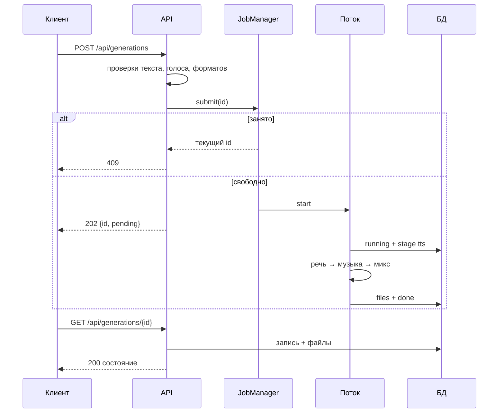

# Задачи генерации

> **Автосгенерировано** из OpenSpec capability `generation-jobs`. Не редактировать
> вручную: изменения вносятся через OpenSpec change. Автор изменений: Andrey Zaharov.
> Дата: 2026-11-26.
>
> Внутренний источник: OpenSpec в этом репозитории, `openspec/specs/generation-jobs/spec.md`.
> Публичной ссылки на спеку нет.

## Что это

Единственный способ превратить текст в готовый файл: постановка задачи, работа
в фоне в три стадии, опрос состояния и список последних задач. Одна генерация
одновременно — так модель не грузится дважды и не конкурирует за память.

Поведение описано требованиями «Постановка задачи», «Одна генерация
одновременно», «Стадии выполнения», «Режим задачи», «Опрос состояния», «История
задач», «Ошибка пайплайна», «Восстановление после рестарта», «Список голосов».

## Ключевые понятия

| Термин | Значение |
|---|---|
| Задача | Запись в `generations`, идентифицируется uuid; имеет режим `song`/`narrated` |
| Стадия | `tts`, `music`, `mix` — текущий шаг работы |
| Single-flight | Не более одной выполняющейся задачи |
| Занято | Статус ответа `409`, пока задача в `running` |

## Как работает

1. `POST /api/generations` проверяет текст, голос и форматы, создаёт запись
   `pending` и запускает поток, сразу отвечая `202`.
2. Если уже идёт генерация — `409` с идентификатором текущей.
3. Поток в режиме `narrated`: стадии `tts → music → mix`.
   Поток в режиме `song`: стадия `tts` означает синтез вокала NNSVS (под ней же
   строится мелодия) → `music` (подложка MusicGen) → `mix` (сведение и экспорт).
   Режим по умолчанию — `song`.
4. Успех: статус `done`, длительность, файлы в `generation_files`, `output_path`
   равен пути MP3.
5. Ошибка любой стадии: `failed` с текстом, временные файлы удалены.
6. При старте приложения все `running` переводятся в `failed` с причиной.

## Контракты

| Метод | Путь | Успех | Ошибки |
|---|---|---|---|
| POST | `/api/generations` | `202` {id, status, mode} | `400` голос/формат/режим, `409` занято, `422` текст |
| GET | `/api/generations/{id}` | `200` состояние | `404` |
| GET | `/api/generations?limit=N` | `200` список, новые первыми | — |
| GET | `/api/voices` | `200` голоса | `502` |

Состояние задачи: `id`, `status`, `stage`, `created_at`, `finished_at`,
`duration_seconds`, `files` (формат → путь), `error`.

## Диаграммы



## Ошибки и ограничения

- Остановка сервера не ждёт генерацию: задача останется `running` до следующего
  старта, тогда станет `failed`.
- Отмены нет; постановка в занятый движок отклоняется, а не встаёт в очередь.
- Single-flight действует внутри процесса; второй экземпляр на той же базе его
  не увидит.
- Ошибки пайплайна не возвращаются синхронно — их надо смотреть опросом.
- Первый POST в процессе может быть медленнее: проверка голоса тянет список
  провайдера.
- В истории сохраняются текст, голос, теги музыки и seed; `rate_percent`,
  `pitch_hz` и `growl` в базу не пишутся — задачу с ними нельзя воспроизвести
  по истории (кандидат на фазу UI/настроек).

## Диагностика (QA)

```
curl -s -X POST localhost:8000/api/generations -H 'content-type: application/json' \
  -d '{"text":"Привет","voice":"ru-RU-DmitryNeural"}'
curl -s localhost:8000/api/generations/<id>
curl -s 'localhost:8000/api/generations?limit=5'
```

- Задача висит в `running` — смотреть stderr: стадия говорит, где встала.
- После рестарта задача `failed` с «прервано перезапуском» — это ожидаемо.
- `409` — дождаться текущей задачи; её id в ответе.
- Тесты: `uv run pytest tests/test_jobs_*.py`.

## Ссылки

- Код: `src/muzifikator/jobs/`, `src/muzifikator/app.py`.
- Смежные capability: `generation-history` (файлы), `speech-synthesis`,
  `music-generation`, `audio-assembly`.
