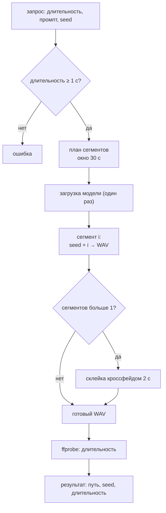

# Генерация музыки

> **Автосгенерировано** из OpenSpec capability `music-generation`. Не редактировать
> вручную: изменения вносятся через OpenSpec change. Автор изменений: Andrey Zaharov.
> Дата: 2026-11-26.
>
> Внутренний источник: OpenSpec в этом репозитории, `openspec/specs/music-generation/spec.md`.
> Публичной ссылки на спеку нет.

## Что это

Инструментальная подложка под речь, сгенерированная локально моделью MusicGen.
Длительность задаётся вызывающей стороной (длиной озвучки), стиль — текстовым
промптом, повторяемость — seed. Трек длиннее окна модели собирается из сегментов
с кроссфейдом.

Поведение описано требованиями «Генерация по промпту и длительности», «Модель из
конфигурации», «Управляемая воспроизводимость», «Сегменты длинного трека»,
«Промпт стиля», «Без кэша музыки», «Один экземпляр модели», «Ошибки ресурсов» и
«Локальность и лицензия».

## Ключевые понятия

| Термин | Значение |
|---|---|
| Окно модели | Максимальная длина одного сегмента, 30 с |
| Сегмент | Один вызов модели длиной не больше окна |
| Кроссфейд | Перекрытие 2 с между соседними сегментами при склейке |
| Seed | Число, определяющее выборку; `seed + i` для сегмента `i` |
| Бэкенд | Обёртка над моделью (`transformers`), грузится лениво и один раз |

## Как работает

1. Запрос проверяется: длительность не меньше 1 с.
2. Промпт берётся из запроса или из конфигурации; seed — из запроса или
   случайный и сохраняется в результате.
3. Длительность режется на сегменты: каждый не больше 30 с, следующий короче,
   если остаток мал; суммарная длительность с учётом кроссфейдов не меньше
   запрошенной.
4. Каждый сегмент генерируется с seed `seed + i` и пишется в WAV (32 кГц, моно,
   16 бит).
5. Сегменты склеиваются кроссфейдом 2 с (один сегмент пишется как есть).
6. Длительность измеряется по готовому файлу; после успешной записи файл получает
   финальное имя.

Кэша нет: каждый вызов — новая генерация.

## Контракты

Настройки:

| Переменная | По умолчанию | Смысл |
|---|---|---|
| `MUSICGEN_MODEL` | `facebook/musicgen-small` | Веса модели |
| `MUSIC_MODELS_DIR` | `models` | Каталог весов (вне репозитория) |
| `MUSIC_PROMPT` | `folk metal` | Промпт стиля по умолчанию |
| `MUSIC_DEVICE` | `auto` | `auto` / `mps` / `cpu` |

Запрос: длительность в секундах, промпт (необязательный), seed (необязательный).
Результат: путь к WAV, фактическая длительность, seed, промпт, модель, число
сегментов.

Ошибки: `MusicError` → `MusicModelError`, `MusicGenerationError`,
`MusicResourceError`.

## Диаграммы

## Ошибки и ограничения

- Первый запуск требует сети для весов; без сети — ошибка с моделью и причиной.
- Генерация идёт на одном устройстве и держит модель в памяти: одновременно один
  трек (очередь задач появится в фазе 6).
- Воспроизводимость — в пределах одного окружения; на другой машине или версии
  `torch` трек может отличаться.
- На стыках сегментов возможна смена музыкального рисунка: сегменты независимы,
  кроссфейд только сглаживает.
- Кэша нет: повторный запрос снова занимает время генерации.
- Файл результата — WAV; обрезка до точной длительности речи и фейды — фаза 5.

## Диагностика (QA)

- Где веса: `ls models/`; размер ~2 ГБ для small.
- Время генерации 10 с на MPS — ожидаемо десятки секунд; на CPU в разы дольше.
- Длительность и параметры: `ffprobe -v error -show_entries format=duration -of default=nw=1:nk=1 <файл>`.
- Повторить трек: взять `seed` из результата и передать тем же промптом.
- «Не хватает памяти» — уменьшить длительность или переключить `MUSIC_DEVICE=cpu`.
- Тесты без модели: `uv run pytest tests/test_music_*.py`; с моделью — `uv run pytest -m model`.

## Ссылки

- Код: `src/muzifikator/music/`, `src/muzifikator/media.py`.
- Лицензия весов: `docs/licenses.md`.
- Смежные capability: `speech-synthesis` (длительность речи задаёт длину трека),
  `ffmpeg-preflight` (пути бинарей).
