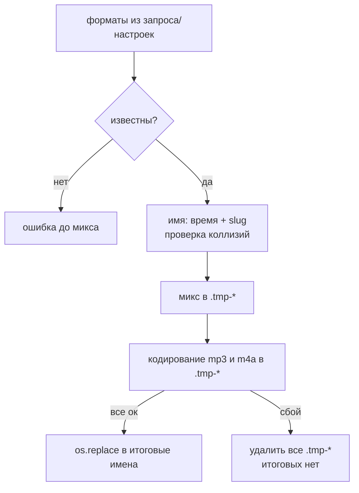

# Выходные файлы

> **Автосгенерировано** из OpenSpec capability `output-files`. Не редактировать
> вручную: изменения вносятся через OpenSpec change. Автор изменений: Andrey Zaharov.
> Дата: 2026-11-26.
>
> Внутренний источник: OpenSpec в этом репозитории, `openspec/specs/output-files/spec.md`.
> Публичной ссылки на спеку нет.

## Что это

Правила, по которым готовое аудио попадает на диск: в каком формате, под каким
именем, в каком каталоге и что происходит при сбое. Отдельная capability, потому
что это правила хранения результата, а не сведения звука.

Поведение описано требованиями «Форматы экспорта», «Имя файла», «Выходной
каталог», «Подкаталог результата», «Атомарная запись», «Защита от перезаписи» и
«Отчёт о результате».

## Ключевые понятия

| Термин | Значение |
|---|---|
| `OUTPUT_DIR` | Каталог результатов, по умолчанию `out/` |
| `OUTPUT_FORMATS` | Список форматов через запятую, по умолчанию `mp3,m4a` |
| `folder` | Необязательный подкаталог `OUTPUT_DIR` для задачи |
| Slug | Часть имени из начала текста: латиница, цифры, дефисы; до 40 знаков |
| Мастер | Временный WAV 44,1 кГц, из которого кодируются форматы |

## Как работает

1. Форматы берутся из запроса или настройки; неизвестный формат — ошибка до
   начала микса.
2. Имя собирается из локального времени и slug: кириллица транслитерируется
   (`привет` → `privet`), остальные посторонние символы заменяются дефисом; при
   занятом имени добавляется числовой суффикс.
3. Если задан подкаталог, он разрешается внутри выходного каталога и
   создаётся; микс и `.tmp-*` файлы живут в нём.
4. Микс пишется в `.tmp-*` файлы внутри выходного каталога, затем кодируются все
   запрошенные форматы.
4. Только после успешного кодирования всех форматов временные файлы
   переименовываются в итоговые. Сбой любого формата удаляет всё временное.

## Контракты

| Настройка | По умолчанию | Смысл |
|---|---|---|
| `OUTPUT_DIR` | `out` | Куда писать результаты |
| `OUTPUT_FORMATS` | `mp3,m4a` | Какие форматы делать |

Параметры кодирования: MP3 VBR `-q:a 2`, AAC 192 кбит/с, 44,1 кГц, моно.

Имя: `YYYYMMDD-HHMMSS-<slug>.<ext>`; при коллизии — `…-2`, `…-3`.
Запасной slug при пустом результате — `audio`.

Транслитерация: «Привет, мир!» → `privet-mir`, «Ёлка» → `elka`,
«Щука» → `shchuka`. Имена переносимы между файловыми системами и не зависят от
локали оболочки.

## Диаграммы

## Ошибки и ограничения

- Существующий файл никогда не перезаписывается: вместо этого появляется
  суффикс.
- `out/` не входит в репозиторий; при смене `OUTPUT_DIR` стоит убедиться, что
  каталог тоже вне git.
- Транслитерация необратима: по имени нельзя восстановить исходные буквы, текст
  остаётся в истории генераций.
- Временные файлы начинаются с `.tmp-`: если процесс убили посреди микса, они
  останутся и видны как скрытые файлы, итоговых не будет.
- Подкаталог может быть вложенным (`2026/11/26`): создаются все уровни. Выход за
  `OUTPUT_DIR` и абсолютные пути отклоняются до записи.
- Формат AAC зависит от сборки ffmpeg; при его отсутствии ошибка появится на
  шаге кодирования.

## Диагностика (QA)

- Что создано: `ls -la out/`.
- Кодек и параметры: `ffprobe -v error -show_entries stream=codec_name,sample_rate,channels -of default=nw=1 <файл>`.
- «Файл не появился, ошибка про AAC» — проверить сборку: `ffmpeg -encoders | grep aac`.
- «Не нашёл нужный файл» — посмотреть суффиксы: при совпадении времени имя
  получает `-2`.
- «В имени не то слово» — транслит упрощённый: `ё` → `e`, `й` → `i`, `ъ`/`ь`
  отбрасываются.
- Тесты: `uv run pytest tests/test_output_*.py`.

## Ссылки

- Код: `src/muzifikator/assembly/files.py`.
- Смежные capability: `audio-assembly`.
