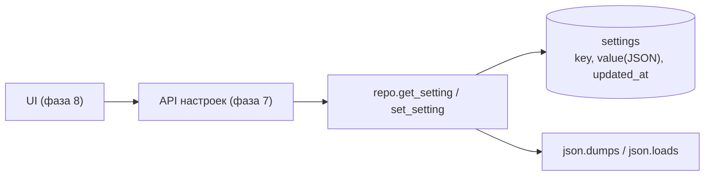

# Сохранённые настройки

> **Автосгенерировано** из OpenSpec capability `persisted-settings`. Не редактировать
> вручную: изменения вносятся через OpenSpec change. Автор изменений: Andrey Zaharov.
> Дата: 2026-11-26.
>
> Внутренний источник: OpenSpec в этом репозитории, `openspec/specs/persisted-settings/spec.md`.
> Публичной ссылки на спеку нет.

## Что это

Пользовательские настройки, которые переживают перезапуск: выбранный голос,
провайдер озвучки, теги музыки, последняя папка вывода. Хранятся в базе, а не в
файле рядом с кодом, чтобы меняться из UI и не конфликтовать с ручными правками.

Поведение описано требованиями «Сохранение настройки», «Чтение настройки»,
«Составные значения», «Сохранность между перезапусками» и «Независимость от
истории».

## Ключевые понятия

| Термин | Значение |
|---|---|
| Ключ | Строка, например `tts_voice` или `music_tags` |
| Значение | Любое JSON-совместимое: строка, число, bool, список, объект, `null` |
| Отсутствие ключа | Ключа нет в базе — это не то же самое, что сохранённый `null` |

## Как работает

`set_setting` пишет значение целиком и обновляет время изменения: частичного
слияния объектов нет. `get_setting` возвращает сохранённое значение; если ключа
нет, возвращает переданное значение по умолчанию, а если оно не передано —
признак отсутствия. Различие «нет ключа» и «сохранён null» сохранено намеренно:
сброс значения и отсутствие настройки — разные состояния.

Значения сериализуются в JSON с `ensure_ascii=False`, поэтому русский текст
читается глазами прямо в базе.

## Контракты

Таблица `settings`:

| Поле | Обязательно | Смысл |
|---|---|---|
| `key` | да | Первичный ключ |
| `value` | да | JSON-текст значения |
| `updated_at` | да | Время последнего изменения, UTC |

Ключ `output_dir` хранит действующий каталог сохранения: абсолютный путь к
существующему каталогу, доступному на запись. Он нормализуется перед записью и
проверяется при каждом обновлении; без сохранённого значения действует
`OUTPUT_DIR` (по умолчанию `~/muzifikator`).

Функции:
- `set_setting(session, key, value)` — вставка или замена целиком.
- `get_setting(session, key, default=...)` — значение, иначе `default`;
  без `default` — признак отсутствия.

## Диаграммы

## Ошибки и ограничения

- Значение, которое нельзя сериализовать в JSON, отклоняется на записи, а не
  портит базу.
- Частичного обновления объекта нет: чтобы изменить одно поле, читается объект
  целиком, правится и сохраняется целиком.
- Настройки не влияют на историю: строки `generations` хранят собственные
  параметры на момент генерации и не меняются задним числом при смене настроек.
- Очистки истории настройки не боятся; удаление базы удаляет и их.

## Диагностика (QA)

- `sqlite3 data/muzifikator.sqlite3 'select key,value,updated_at from settings order by key;'`
- Значение читается как JSON; если в базе невалидный JSON, это следствие ручной
  правки, а не работы приложения.
- «Настройка не применилась» — проверить `commit`: слой доступа не коммитит сам.
- Тесты: `uv run pytest tests/test_settings.py`.

## Ссылки

- Код: `src/muzifikator/storage/repo.py`, `src/muzifikator/storage/models.py`.
- Смежные capability: `generation-history`, `storage-schema`.
