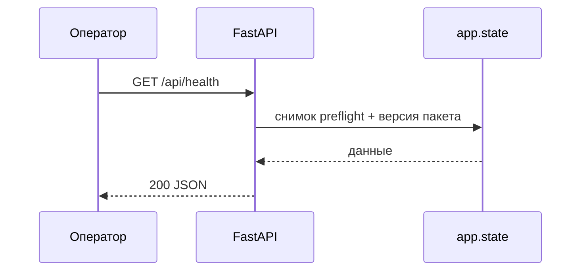

# Состояние сервиса (`/api/health`)

> **Автосгенерировано** из OpenSpec capability `service-health`. Не редактировать
> вручную: изменения вносятся через OpenSpec change. Автор изменений: Andrey Zaharov.
> Дата: 2026-11-25.
>
> Внутренний источник: OpenSpec в этом репозитории, `openspec/specs/service-health/spec.md`.
> Публичной ссылки на спеку нет.

## Что это

Один HTTP-эндпоинт, по которому видно, что сервис поднят, какой он версии и с
какими внешними бинарями работает. Нужен, чтобы отличать «сервис не запущен» от
«сервис запущен, но что-то не так», не запуская генерацию.

Поведение описано требованиями «Эндпоинт состояния», «Состав ответа», «Health не
запускает внешние процессы» и «Локальность и отсутствие утечек».

## Ключевые понятия

| Термин | Значение |
|---|---|
| Health | `GET /api/health` — состояние сервиса |
| Снимок preflight | Результат проверки `ffmpeg`/`ffprobe`, полученный при старте |
| `app_version` | Версия пакета из метаданных; `unknown`, если метаданных нет |

## Как работает

При создании приложения снимок preflight кладётся в состояние приложения.
Обработчик health ничего не проверяет: он сериализует уже готовый снимок и
версию. Поэтому запрос дешёвый и не порождает процессов, а ответы на повторные
запросы в пределах одного процесса одинаковы.

Так как при непригодном окружении процесс не стартует, эндпоинт существует
только у работающего сервиса; отдельного «деградированного» статуса нет.

## Контракты

`GET /api/health` — без параметров и тела. Ответ `200`, `application/json`:

```json
{
  "status": "ok",
  "app_version": "0.1.0",
  "binaries": {
    "ffmpeg": {"available": true, "path": "/opt/homebrew/bin/ffmpeg", "version": "7.1"},
    "ffprobe": {"available": true, "path": "/opt/homebrew/bin/ffprobe", "version": "7.1"}
  }
}
```

| Поле | Тип | Смысл |
|---|---|---|
| `status` | строка | `ok` у работающего сервиса |
| `app_version` | строка | Версия пакета или `unknown` |
| `binaries` | объект | Записи `ffmpeg` и `ffprobe`, обе всегда присутствуют |
| `binaries.*.available` | bool | Бинарь пригоден |
| `binaries.*.path` | строка или null | Разрешённый путь |
| `binaries.*.version` | строка или null | Версия; null — не извлечена |
| `binaries.*` (прочие) | — | Прочие поля снимка не публикуются |

Метод, отличный от `GET`, получает `405`.

## Диаграммы



## Ошибки и ограничения

- Эндпоинт не является мониторингом внешних бинарей в реальном времени:
  подмена ffmpeg на работающем сервисе видна только после перезапуска.
- `status` никогда не бывает «плохим»: при плохом окружении сервиса просто нет.
- Ответ не содержит конфигурацию, переменные окружения, пути к данным и тексты —
  только бинари и версию приложения.
- Health не требует авторизации; сервис слушает loopback по умолчанию, наружу не
  публикуется.

## Диагностика (QA)

- `curl -s http://127.0.0.1:8000/api/health | jq` — ожидаются `status: ok` и пути
  бинарей.
- `curl -s -o /dev/null -w '%{http_code}' -X POST http://127.0.0.1:8000/api/health`
  — ожидается `405`.
- Если `version` равен `null`, сверить вывод `ffmpeg -version` руками: версия не
  извлекается, но бинарь при этом рабочий.
- Если подключение отклонено — процесс не запущен; смотреть stderr, там причина
  отказа preflight.

## Ссылки

- Код: `src/muzifikator/app.py`.
- Снимок: capability `ffmpeg-preflight`, `docs/capabilities/ffmpeg-preflight.md`.
- Запуск: `docs/operations.md`.
