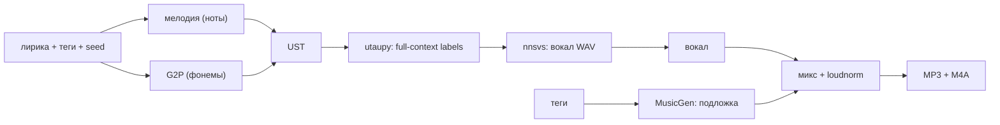

# Пение

> **Автосгенерировано** из OpenSpec capability `singing-synthesis`. Не редактировать
> вручную. Автор изменений: Andrey Zaharov. Дата: 2026-11-26.
>
> Внутренний источник: `openspec/specs/singing-synthesis/spec.md`.

## Что это

Русское пение из лирики и тегов локальной моделью NNSVS с банком «Llane Crow»:
мелодия строится по слогам, лирика раскладывается на русские фонемы, модель поёт,
результат — вокал WAV. В режиме `song` поверх вокала кладётся инструментальная
подложка MusicGen и всё миксуется в готовый файл.

Поведение описано требованиями «Синтез пения по лирике», «Мелодия и фонемы»,
«Вокал и детерминизм», «Отказ модели» и «Локальность».

## Ключевые понятия

| Термин | Значение |
|---|---|
| Лирика | Входной текст песни |
| Мелодия | Ноты: одна на слог, тональность/темп из тегов |
| G2P | Русская графема → фонемы |
| Лейблы | full-context labels для NNSVS, строятся из UST |
| Вокал | Поющий голос в WAV, без подложки |

## Как работает

1. Лирика проверяется (непустая), seed фиксирует генератор мелодии.
2. Мелодия: нота на слог, гамма из тегов, тоника в конце фразы.
3. G2P раскладывает слова на русские фонемы; ноты + фонемы → UST.
4. `utaupy` превращает UST в full-context labels, `nnsvs` синтезирует WAV.
5. В режиме `song` подложка MusicGen генерируется по тегам, вокал и подложка
   миксуются (`amix` + `loudnorm`), результат кодируется в MP3/M4A.

Модель загружается один раз на процесс; сеть в рантайме не используется.

## Контракты

Вход: лирика, теги, seed. Выход: вокал WAV и длительность; в режиме `song` —
готовые файлы подложки+вокала.

Ошибки: `SingingError` → `SingingModelError`, `SingingSynthesisError`,
`SingingPhonemizerError`.

## Диаграммы

## Ошибки и ограничения

- Нет весов модели — ошибка с именем модели, файл не создаётся.
- Русская G2P грубая: незнакомые имена и редкие слова могут читаться неточно.
- Голос в режиме `song` не выбирается: поёт фиксированный банк «Llane Crow».
- Детерминизм — в пределах одного окружения, как у генерации музыки.
- Робот-пение (TTS+WORLD) остаётся dev-инструментом, результатом не является.

## Диагностика (QA)

- Вокал отдельно: вызвать сервис напрямую и послушать WAV до микса.
- «Не поёт» — проверить веса в `models/nnsvs/` и импорт `nnsvs`.
- «Слова не те» — смотреть G2P-разбивку в логе/тесте.
- Тесты: `uv run pytest tests/test_singing_*.py`; реальная модель — `-m model`.

## Ссылки

- Код: `src/muzifikator/singing/`.
- Смежные: `generation-jobs` (режим), `music-generation` (подложка),
  `audio-assembly` (экспорт).
