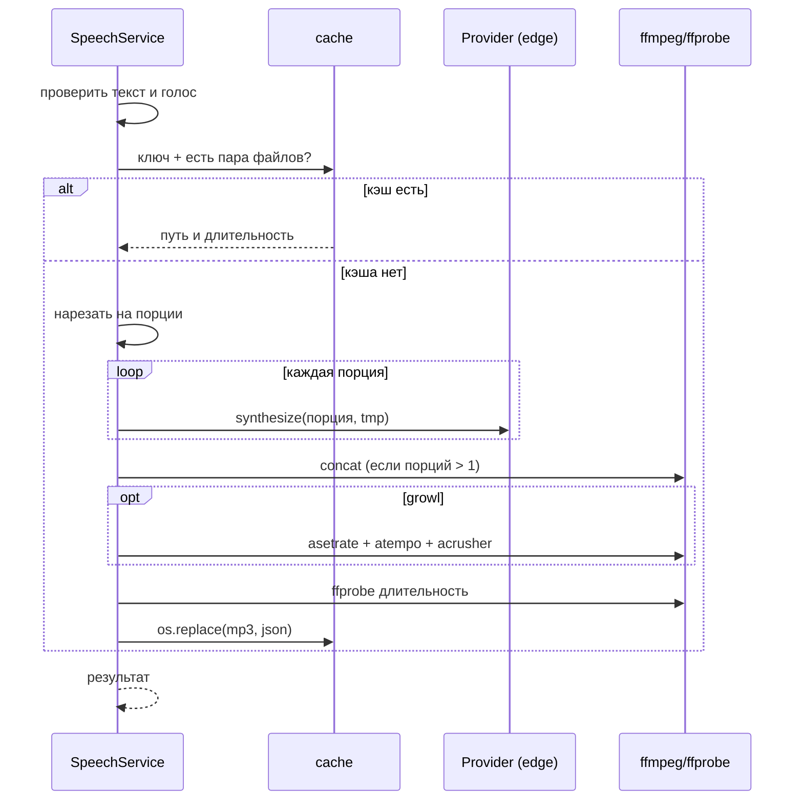

# Синтез речи

> **Автосгенерировано** из OpenSpec capability `speech-synthesis`. Не редактировать
> вручную: изменения вносятся через OpenSpec change. Автор изменений: Andrey Zaharov.
> Дата: 2026-11-26.
>
> Внутренний источник: OpenSpec в этом репозитории, `openspec/specs/speech-synthesis/spec.md`.
> Публичной ссылки на спеку нет.

## Что это

Превращает текст в MP3 с речью заданным голосом. Провайдер синтеза скрыт за
интерфейсом: сейчас это edge-tts, в фазе 9 появится локальный. Сервис слоя речи
отвечает за всё, что не зависит от провайдера: кэш и его лимит на диске,
разбиение длинного текста, склейку, «рык» и измерение длительности.

Поведение описано требованиями «Интерфейс провайдера синтеза», «Провайдер
edge-tts», «Список голосов», «Формат и длительность результата», «Кэш озвучки»,
«Лимит кэша», «Обработка „рык“», «Длинный текст» и «Локальность данных».

## Ключевые понятия

| Термин | Значение |
|---|---|
| Провайдер | Источник речи: `edge` и, позже, локальный |
| Кэш | Каталог `.cache/tts/` с файлами `<key>.mp3` и sidecar `<key>.json` |
| Лимит кэша | `TTS_CACHE_LIMIT_MIB`, по умолчанию 200 МиБ; `0` — без лимита |
| LRU | Порядок вытеснения по времени последнего обращения |
| Ключ кэша | sha256 от провайдера, голоса, темпа, тона, рыка и текста |
| Рык | Обработка голоса: понижение тона + сатурация с сохранением длительности |
| Порция | Часть текста, которую можно отдать провайдеру одним запросом |

## Как работает

1. Запрос проверяется: текст не пустой, голос известен.
2. Считается ключ кэша; при наличии пары `.mp3` + `.json` результат берётся из
   кэша вместе с сохранённой длительностью.
3. Иначе текст режется на порции по границам предложений; каждая порция
   синтезируется провайдером во временный файл.
4. Порции склеиваются в один MP3 (если их больше одной).
5. При включённом рыке применяется ffmpeg-фильтр: понижение тона и сатурация,
   скорость компенсируется, длительность почти не меняется.
6. Длительность измеряется `ffprobe` по готовому файлу.
7. Результат атомарно переносится в кэш вместе с sidecar-метаданными.
8. Если кэш превысил лимит, удаляются записи, к которым дольше всего не
   обращались; время обращения обновляется и при попадании в кэш.

Список голосов запрашивается у провайдера один раз за процесс и хранится в
экземпляре провайдера.

## Контракты

Провайдер (`Protocol`):

| Элемент | Смысл |
|---|---|
| `name` | Имя в кэше и ошибках (`edge`) |
| `max_text_length` | Лимит одной порции |
| `list_voices()` | Список `Voice`: имя, локаль, пол |
| `synthesize(request, target)` | Записать речь в `target` |

Запрос: текст, голос, темп (`rate_percent`, целое), тон (`pitch_hz`, целое),
`growl` (bool). Результат: путь, длительность в секундах, провайдер, признак
«из кэша», признак рыка.

Sidecar кэша: провайдер, голос, параметры, длительность, длина текста, время
создания, sha256 текста. Время последнего обращения хранится в `mtime` файла
`.mp3`; в лимит входят и `.mp3`, и `.json`.

Ошибки: `SpeechError` → `SynthesisError`, `VoiceListError`, `UnknownVoiceError`,
`AudioProcessingError`.

## Диаграммы

## Ошибки и ограничения

- Нет сети — нет нового синтеза: `SynthesisError` с причиной; ранее
  закэшированное продолжает работать.
- Рык меняет длительность в пределах долей секунды; на границах допуска 0,2 с
  возможны редкие расхождения на очень коротких фразах.
- Кэш ограничен размером: при превышении удаляются самые давние записи. Полная
  очистка — вручную (см. `docs/operations.md`).
- Лимит проверяется после записи: если он уменьшен сильно ниже текущего размера,
  одна генерация может удалить сразу много записей.
- Файл, только что записанный, не вытесняется: у него самое свежее обращение.
- Один и тот же текст с другим темпом, тоном или рыком — отдельная запись кэша,
  файлы не переиспользуются.
- Вызов изнутри работающего event loop даёт явную ошибку: слой синхронный,
  рассчитан на пул потоков.
- Список голосов кэшируется в памяти: добавленный на стороне сервиса голос
  появится только после перезапуска.

## Диагностика (QA)

- Файлы кэша: `ls -la .cache/tts | head`; sidecar читается глазами — там
  параметры и длительность.
- Размер кэша и место: `du -sh .cache/tts`; лимит — `echo $TTS_CACHE_LIMIT_MIB`.
- Вытеснение видно по исчезновению старых пар файлов; ошибки удаления пишутся
  предупреждением в лог и синтез не прерывают.
- Промах кэша виден по новому файлу и по времени изменения sidecar.
- Ошибка `ffprobe` — проверить файл руками:
  `ffprobe -v error -show_entries format=duration -of default=nw=1:nk=1 <файл>`.
- Сетевые отказы — запустить синтез повторно; при повторной ошибке проверить
  доступность endpoint edge-tts.
- Тесты: `uv run pytest tests/test_speech_*.py`; сетевой тест — `uv run pytest -m network`.

## Ссылки

- Код: `src/muzifikator/speech/`.
- Запуск и окружение: `docs/operations.md`.
- Смежные capability: `ffmpeg-preflight` (пути бинарей), `generation-history`
  (запись о генерации в фазе 6).
