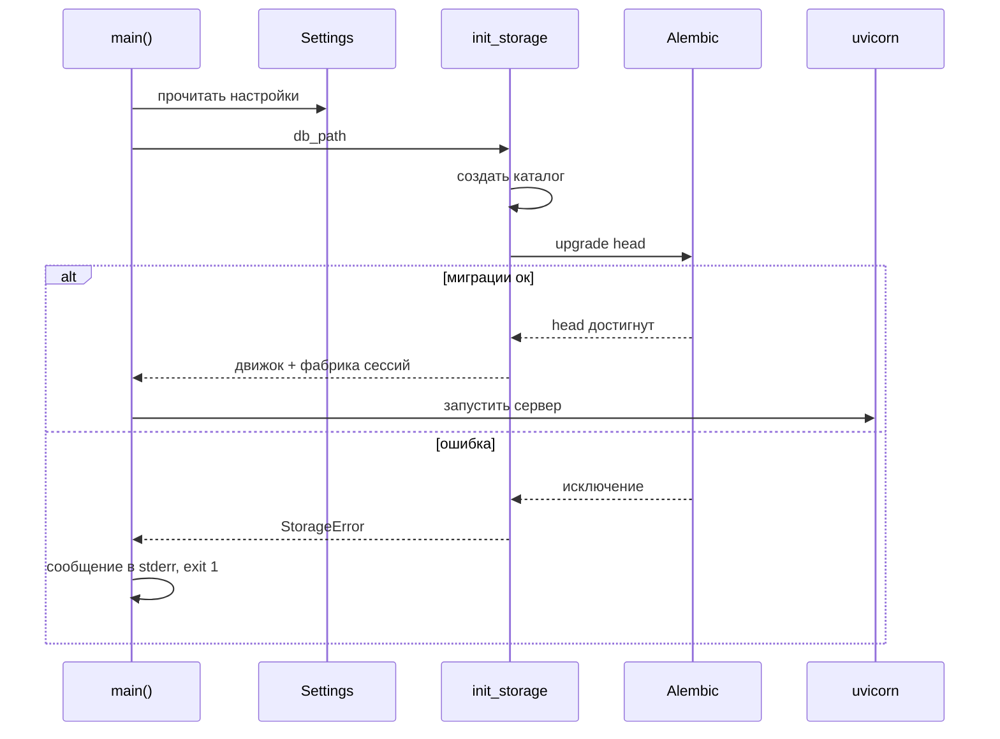

# Схема хранилища и миграции

> **Автосгенерировано** из OpenSpec capability `storage-schema`. Не редактировать
> вручную: изменения вносятся через OpenSpec change. Автор изменений: Andrey Zaharov.
> Дата: 2026-11-26.
>
> Внутренний источник: OpenSpec в этом репозитории, `openspec/specs/storage-schema/spec.md`.
> Публичной ссылки на спеку нет.

## Что это

Держит схему базы в актуальном состоянии без ручных команд: при старте
приложение находит или создаёт файл базы, применяет недостающие миграции и
только потом открывает порт. Если база недоступна или миграция падает, сервис не
запускается — вместо работы на полупустой схеме.

Поведение описано требованиями «Расположение базы», «Автоматическое применение
миграций» и «Отказ при недоступной базе».

## Ключевые понятия

| Термин | Значение |
|---|---|
| `DB_PATH` | Переменная конфигурации с путём к файлу базы; по умолчанию `data/muzifikator.sqlite3` |
| Ревизия | Запись в служебной таблице Alembic `alembic_version` |
| `head` | Последняя известная ревизия в каталоге `migrations/versions/` |
| `init_storage` | Функция старта: каталог → движок → `upgrade head` |

## Как работает

Порядок старта процесса:

1. Настройки, логирование.
2. Preflight `ffmpeg`/`ffprobe` — дешевле и ломается чаще.
3. `init_storage`: создать каталог базы, создать движок, применить миграции до
   `head`.
4. `uvicorn` открывает порт.

Схема описывается моделями SQLAlchemy в `storage/models.py`, а версии — файлами в
`migrations/versions/`. Один источник правды для URL базы — конфигурация
приложения: `migrations/env.py` берёт путь из `Settings`, а не из `alembic.ini`.

## Контракты

| Переменная | По умолчанию | Смысл |
|---|---|---|
| `DB_PATH` | `data/muzifikator.sqlite3` | Файл базы; каталог создаётся при старте |

Ручные команды (только для разработки):

```
uv run alembic upgrade head                    # применить миграции вручную
uv run alembic revision --autogenerate -m "…"  # заготовка миграции
uv run alembic current                          # текущая ревизия
```

`alembic.ini` не содержит URL: он подставляется в `migrations/env.py`.

## Диаграммы



## Ошибки и ограничения

- Авто-миграции выполняются при каждом старте; повторный запуск на актуальной
  базе ничего не меняет.
- База — обычный файл, который не коммитится. Перед обновлением приложения её
  стоит скопировать: неудачная миграция блокирует запуск, а не портит данные
  молча.
- WAL-режим создаёт рядом файлы `-wal` и `-shm`; они лежат в `data/` и в
  репозиторий не попадают.
- `Base.metadata.create_all()` не используется нигде, включая тесты: только
  миграции, иначе схема и история ревизий расходятся.
- Один процесс на файл базы: параллельный запуск двух экземпляров не
  поддерживается.

## Диагностика (QA)

- Где база: `echo $DB_PATH` или значение по умолчанию `data/muzifikator.sqlite3`.
- Текущая ревизия: `uv run alembic current`.
- Таблицы: `sqlite3 data/muzifikator.sqlite3 '.tables'`.
- «Не стартует, в stderr ошибка миграции» — прочитать текст; часто это
  несовместимая база от старой версии, помогает копия файла и `alembic upgrade`.
- «Не стартует, база недоступна» — проверить права на каталог `data/` и
  свободное место на диске.

## Ссылки

- Код: `src/muzifikator/storage/db.py`, `alembic.ini`, `migrations/`.
- Запуск и окружение: `docs/operations.md`.
- Смежные capability: `generation-history`, `persisted-settings`.
