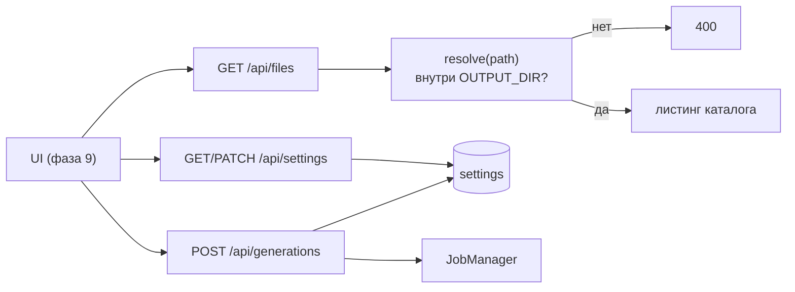

# Веб-интерфейс: файлы и настройки

> **Автосгенерировано** из OpenSpec capability `web-interface`. Не редактировать
> вручную: изменения вносятся через OpenSpec change. Автор изменений: Andrey Zaharov.
> Дата: 2026-11-26.
>
> Внутренний источник: OpenSpec в этом репозитории, `openspec/specs/web-interface/spec.md`.
> Публичной ссылки на спеку нет.

## Что это

HTTP-поверхность для будущего UI: список готовых файлов в выходном каталоге и
сохранённые пользовательские настройки, которые применяются к новым задачам.
Сам UI появится в следующей фазе; здесь — только API с защитой путей.

Поведение описано требованиями «Листинг файлов», «Защита путей», «Чтение
настроек», «Запись настроек» и «Настройки как умолчания задачи».

## Ключевые понятия

| Термин | Значение |
|---|---|
| Корень | Абсолютный путь `OUTPUT_DIR`; всё, что вне него, недоступно |
| Запись | Файл или каталог в листинге с относительным путём |
| Белый список | Настройки, которые можно менять через API |
| Действующее значение | Сохранённое значение или умолчание из конфигурации |

## Как работает

**Файлы.** `GET /api/files?path=<относительный>` возвращает содержимое каталога:
корень, запрошенный путь и записи. Путь приводится к абсолютному через
`resolve()`, поэтому и `..`, и симлинк наружу отсекаются одной проверкой «внутри
корня».

**Настройки.** `GET /api/settings` — действующие значения.
`PATCH /api/settings` — частичное обновление: сначала валидация всех ключей,
потом запись одной транзакцией. Неизвестный ключ или плохое значение — `400`,
ничего не меняется.

**Постановка задачи.** Отсутствующие в запросе параметры берутся из настроек,
явные — главнее. Голос можно не указывать, если он сохранён.

## Контракты

| Метод | Путь | Ответ |
|---|---|---|
| GET | `/api/files?path=` | `{root, path, entries[]}`; `400` плохой путь, `404` нет каталога |
| GET | `/api/settings` | действующие значения по белому списку |
| PATCH | `/api/settings` | обновлённое состояние; `400` на плохой ключ/значение |

Запись листинга: `name`, `path` (относительно корня), `kind` (`file`/`dir`),
`size`, `modified_at`.

Белый список настроек:

| Ключ | Умолчание |
|---|---|
| `tts_voice` | нет |
| `music_tags` | `MUSIC_PROMPT` |
| `rate_percent` | 0 |
| `pitch_hz` | 0 |
| `growl` | false |
| `output_formats` | `OUTPUT_FORMATS` |

## Диаграммы



## Ошибки и ограничения

- Выход за `OUTPUT_DIR`, абсолютные пути, симлинки наружу и путь к файлу вместо
  каталога — `400`; отсутствующий каталог — `404`.
- Листинг без пагинации: очень большой каталог отдаётся целиком.
- Скачивания нет: API отдаёт только метаданные. Файл забирается из файловой
  системы.
- Голос в настройках не проверяется на существование: проверка происходит при
  постановке задачи.
- Настройки влияют только на новые задачи; уже идущая задача использует
  разрешённые при постановке значения.
- Изменение `MUSIC_PROMPT`/`OUTPUT_FORMATS` в окружении требует перезапуска —
  это умолчания приложения, а не сохранённые настройки.

## Диагностика (QA)

```
curl -s 'localhost:8000/api/files?path=' | python3 -m json.tool
curl -s localhost:8000/api/settings
curl -s -X PATCH localhost:8000/api/settings -H 'content-type: application/json' \
  -d '{"tts_voice":"ru-RU-DmitryNeural","music_tags":"folk metal"}'
```

- `400` на путь — проверить, что путь относительный и внутри `OUTPUT_DIR`.
- `404` на листинг — каталога нет; корень создаётся при старте, вложенный может
  отсутствовать.
- Настройка не применилась к задаче — проверить, что поле не передано в запросе
  явно: явное значение главнее.
- Тесты: `uv run pytest tests/test_api_*.py`.

## Ссылки

- Код: `src/muzifikator/api/`.
- Смежные capability: `persisted-settings` (хранение), `generation-jobs`
  (постановка), `output-files` (каталог и имена).
