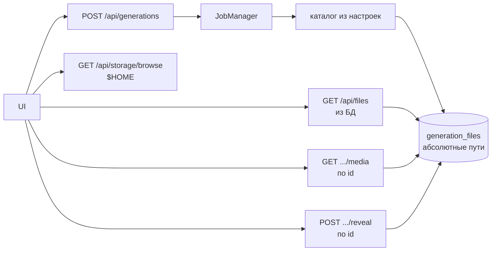

# Веб-интерфейс

> **Автосгенерировано** из OpenSpec capability `web-interface`. Не редактировать
> вручную: изменения вносятся через OpenSpec change. Автор изменений: Andrey Zaharov.
> Дата: 2026-11-26.
>
> Внутренний источник: OpenSpec в этом репозитории, `openspec/specs/web-interface/spec.md`.
> Публичной ссылки на спеку нет.

## Что это

Страница генерации и библиотека готовых файлов. Интерфейс — статика без сборки:
ввести текст, выбрать голос и теги, увидеть прогресс по стадиям, проиграть трек,
открыть его в системном менеджере и выбрать каталог хранения. Список файлов
строится по базе, а не по содержимому диска.

Поведение описано требованиями «Статический интерфейс», «Форма генерации»,
«Прогресс задачи в интерфейсе», «Результат в интерфейсе», «Перегенерация»,
«Настройки в интерфейсе», «Список файлов из базы», «Обозреватель каталогов»,
«Проигрывание файлов», «Открытие в файловом менеджере», «Удаление генерации»,
«Плеер, кнопки и удаление в интерфейсе», «Чтение настроек», «Запись настроек» и
«Настройки как умолчания задачи».

## Ключевые понятия

| Термин | Значение |
|---|---|
| Каталог хранения | Действующий абсолютный путь сохранения; настройка `output_dir` или `OUTPUT_DIR` |
| Запись файла | Строка `generation_files` с генерацией, форматом и абсолютным путём |
| Обозреватель | Панель выбора каталога, ограниченная `$HOME` |
| `exists` | Есть ли файл записи на диске прямо сейчас |

## Как работает

**Генерация.** Форма без поля папки: текст, голос, теги. Постановка идёт в
`POST /api/generations`, прогресс — опросом стадий. Каталог берётся из настроек в
момент запуска задачи.

**Каталог хранения.** Блок показывает текущий путь. «Изменить» открывает
обозреватель: подкаталоги текущего места, «Выше», ручной ввод абсолютного пути.
Сервер принимает только существующий каталог вне репозитория; после сохранения
новые задачи пишут туда.

**Список файлов.** `GET /api/files` отдаёт записи из базы: имя, формат, путь,
дата, длительность и признак наличия файла. Файлы, созданные не приложением, в
списке не появляются. Для отсутствующих файлов кнопки недоступны.

**Проигрывание и открытие.** Работают по идентификатору записи
(`/api/generations/{id}/files/{format}/…`), путь от клиента не принимается.
Проигрывание поддерживает перемотку (`Range`), открытие выполняет команду ОС:
Finder выделяет файл, Explorer выделяет файл, на Linux открывается каталог.

**Удаление.** «Удалить» на генерации после подтверждения стирает файлы всех
форматов и удаляет записи из базы. Отсутствие файла на диске удалению не мешает;
сбой удаления оставляет записи и показывает причину. История не хранится.

## Контракты

| Метод | Путь | Ответ |
|---|---|---|
| GET | `/` | HTML-страница |
| GET | `/static/*` | CSS и JS из пакета |
| GET | `/api/files?limit=&offset=` | `{files[], has_more}` |
| GET | `/api/generations/{id}/files/{format}/media` | байты файла, `206` на `Range` |
| POST | `/api/generations/{id}/files/{format}/reveal` | успех или `502` |
| DELETE | `/api/generations/{id}` | `204`; файлы и записи удалены, `502` при сбое |
| GET | `/api/storage` | действующий каталог |
| GET | `/api/storage/browse?path=` | подкаталоги внутри `$HOME` |
| GET/PATCH | `/api/settings` | настройки, включая `output_dir` |

Запись списка: `generation_id`, `format`, `name`, `path`, `exists`, `size`,
`created_at`, `duration_seconds`.

## Диаграммы



## Ошибки и ограничения

- Обозреватель показывает только каталоги внутри `$HOME`; иные места достижимы
  только ручным вводом пути и серверной валидацией.
- Список из базы не видит файлов, положенных в каталог вручную; удалённые вручную
  остаются в списке с пометкой.
- Смена каталога не переносит старые файлы и не влияет на текущую задачу.
- Удаление необратимо: файлы стираются, записи исчезают, история не хранится.
- Файлы прежних версий приложению неизвестны: база пересоздаётся, файлы на
  диске остаются.
- «Показать» выполняет локальную команду ОС — сервис нельзя выставлять наружу.
- На Linux выделение файла недоступно: открывается каталог.
- Проигрывание зависит от кодека браузера; m4a в Firefox может не играть.

## Диагностика (QA)

```
curl -s 'localhost:8000/api/files?limit=5' | python3 -m json.tool
curl -s localhost:8000/api/storage
curl -s 'localhost:8000/api/storage/browse?path='
curl -s -X PATCH localhost:8000/api/settings -H 'content-type: application/json' \
  -d '{"output_dir":"/Users/me/muzifikator"}'
```

- Файл есть в списке, но не играет — проверить `exists` и наличие файла на диске.
- Каталог не принимается — проверить абсолютность, существование и права.
- «Показать» не сработало — текст в интерфейсе, полный вывод команды в stderr.
- Удаление вернуло `502` — файл не удаляется (права, занят); записи остались,
  повтор возможен после исправления причины.
- Тесты: `uv run pytest tests/test_api_*.py tests/test_paths.py`.

## Ссылки

- Код: `src/muzifikator/api/`, `src/muzifikator/web/`, `src/muzifikator/paths.py`.
- Смежные capability: `output-files` (пути и каталог), `persisted-settings`
  (настройка `output_dir`), `generation-jobs`.
